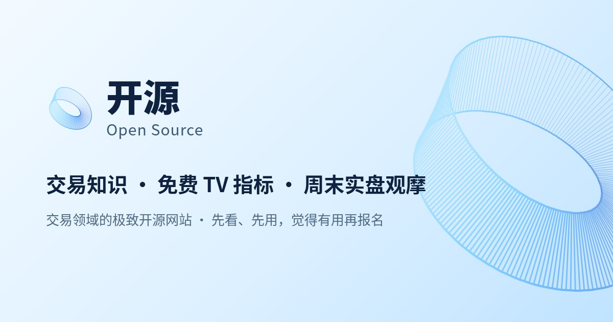

# 嗨，我是 Cami 👋

**中文** · [English](#english)

重本音乐院校毕业，却是一名全职交易员和营养师，完完全全不会写代码。

但我用 AI Agent 把「要是有人能替我干活就好了」变成了一个个真实跑起来的产品：交易平台、拼豆图纸、懒人编程、垃圾清理，都是这么来的。

接下来我还打算继续捣鼓更多东西，希望你也一起参与。

🌍 [开源官网](https://opensourceoss.pages.dev/) · 📱 [下载 APP](https://opensourceoss.pages.dev/download) · 🧩 [全部仓库](https://github.com/chengangrun-ai?tab=repositories)

---

## 作品一览

|  |  |  |
| :---: | :---: | :---: |
| **[删了么](https://github.com/chengangrun-ai/shanleme)**<br>滑卡整理相册：左滑删 · 右滑留 · 上滑精选 | **[拼豆公子](https://github.com/chengangrun-ai/pindou-gongzi)**<br>一张图变成四张成品图 + 带色号图纸 | **[公子图纸原创](https://github.com/chengangrun-ai/gongzi-original)**<br>学出画风，再生成一整套原创图纸 |

|  |  |  |
| :---: | :---: | :---: |
| **[开源 Open Source](https://github.com/chengangrun-ai/opensourceoss)**<br>交易平台：免费 TV 指标 · 量化信号 · 安卓 APP | **[公子教代码做事](https://github.com/chengangrun-ai/gongzi-teaches-code)**<br>写之前先问：这段代码真的需要写吗 | **[Windows 垃圾清理](https://github.com/chengangrun-ai/cleanup-junk)**<br>先扫描出报告，确认后才动手 |

---

## 🆕 最新：开源 · Open Source

**交易领域的极致开源网站** —— 免费 TV 指标、量化信号、软件工具、一周集训课、合作券商，安卓 APP 直接装，一个入口全给。



▶️ [**opensourceoss**](https://github.com/chengangrun-ai/opensourceoss) — 平台介绍仓库：9 张平台实拍截图 + 完整功能介绍
🌍 [opensourceoss.pages.dev](https://opensourceoss.pages.dev/) — 正式网站 ｜ 📱 [下载页](https://opensourceoss.pages.dev/download)

---

## ⭐ 精选项目

用得最多的几个。

🌍 [**开源 Open Source**](https://github.com/chengangrun-ai/opensourceoss) — 交易平台「开源」：免费 TV 指标 · 量化信号 · 一周集训课 · 安卓 APP

🧩 [**拼豆公子**](https://github.com/chengangrun-ai/pindou-gongzi) — 把任何图片变成拼豆图纸：四张成品图 + 带色号图纸 + 文案台账

🏗️ [**camiAI 编程全流程**](https://github.com/chengangrun-ai/camiai-programming-workflow) — 跨产品 MVP 规划、Demo、技术方案、实现与人工验收的工作流 Skill

---

## 🧩 创意与设计

把图片和想法，变成能直接拿去用的成品。

🧩 [**拼豆公子**](https://github.com/chengangrun-ai/pindou-gongzi) — 把任何图片变成拼豆图纸：四张成品图 + 带色号图纸 + 文案台账

🎨 [**公子图纸原创**](https://github.com/chengangrun-ai/gongzi-original) — 看一批参考图，学出画风，再生成一整套原创图纸（15 种画风 / 85 个造型）

---

## 🏗️ 编程工作流

让 Agent 写代码之前，先想清楚该不该写、怎么写。

🏗️ [**camiAI 编程全流程**](https://github.com/chengangrun-ai/camiai-programming-workflow) — 从 MVP 规划到人工验收的五步编程流程

🦥 [**公子教代码做事**](https://github.com/chengangrun-ai/gongzi-teaches-code) — 写之前先问「这段代码真的需要写吗」；含整仓审计 / 欠账本 / 改动审查 / 效果看板 / 速查卡

---

## 🔧 效率工具

替我干活的那些小工具。

🧹 [**Windows 垃圾清理**](https://github.com/chengangrun-ai/cleanup-junk) — 先扫描出报告，确认后才动手，删除一律进回收站

⚙️ [**MT5 编译兜底**](https://github.com/chengangrun-ai/mt5-ex5-fallback) — 沙箱编不出 .ex5 时的替代路径

🔭 [**跨平台调研**](https://github.com/chengangrun-ai/agent-reach) — 跨平台调研搜索，一次查清一个话题

---

## 🚀 怎么用

工具全部是 [Agent Skills](https://agentskills.io/specification) 格式，支持 WorkBuddy、Claude Code、Cursor、Codex 等。

```bash
npx skills add chengangrun-ai/pindou-gongzi
```

或者把仓库链接直接丢给你的 Agent，它会读 `SKILL.md` 自己上手。

---

## English

A music-school graduate. Full-time trader and nutritionist. I do not write code.

But I use AI agents to turn "this should be automatic" into products that actually run — including [Open Source](https://opensourceoss.pages.dev/), a trading-education platform with free TradingView indicators, quant signals and an Android app.

Everything here is in the [Agent Skills](https://agentskills.io/specification) open format. Install with `npx skills add chengangrun-ai/<repo>`.

---

<sub>Follow builders, not influencers.</sub>
